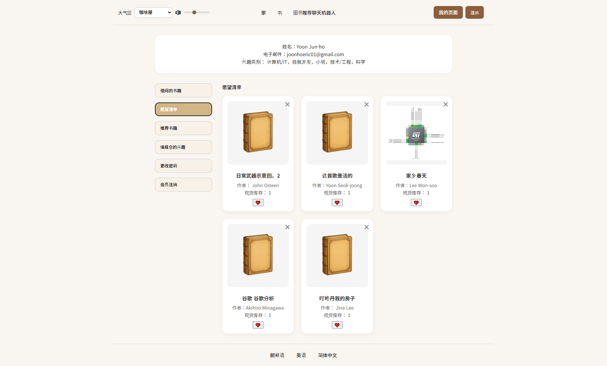
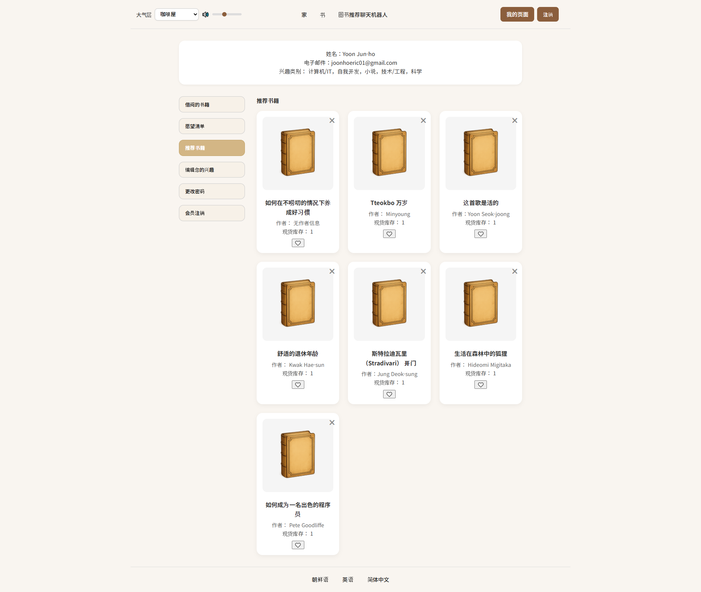
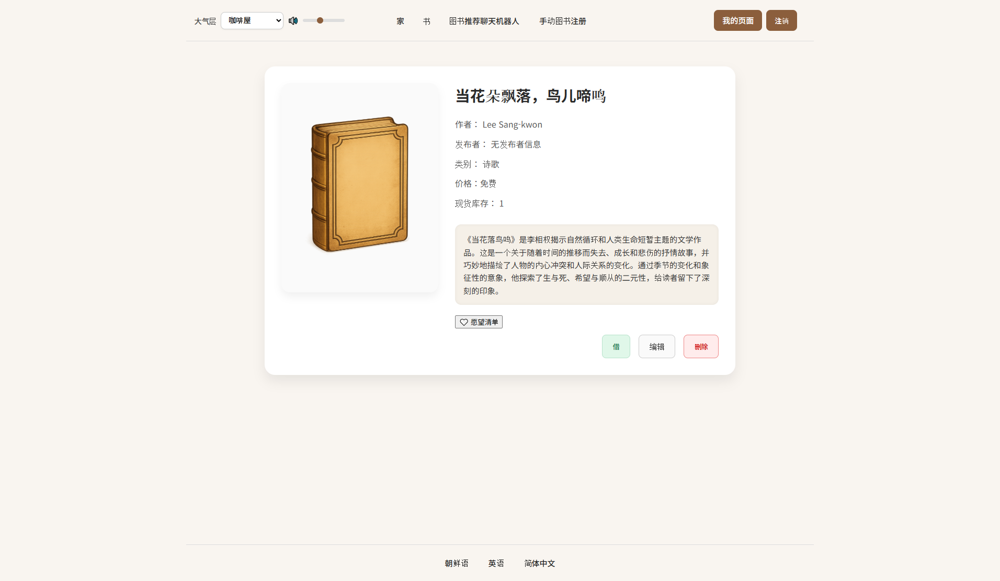

# AI 기반 도서 추천 시스템
### AI-Powered Book Recommendation System

> 사용자가 자신의 감정, 관심 주제, 독서 목적과 상황을 자연어로 설명하면, LLM의 의도 분석과 문장 임베딩 기반 검색을 결합해 관련 도서를 추천하는 온라인 서점 프로토타입입니다.

**2025년 북경과학기술대학교(北京科技大学) 컴퓨터과학기술 전공 개인 졸업프로젝트**로 기획과 데이터 처리, 추천 로직, 백엔드, 프론트엔드 및 기능 테스트를 진행했습니다.

**핵심 기술:** Vue 3, Spring Boot, Python/Flask, MySQL, DeepSeek API, e5-large-v2, Google Books API

**주요 결과:** 논문에 기록된 테스트에서 도서 16권의 AI 요약 배치 처리 시간을 611.7초에서 70.0초로, 추천 요청 전체 응답 시간을 38.015초에서 16.726초로 줄였습니다. 다만 측정 표본과 환경 정보가 제한되어 있으므로 일반적인 서비스 성능이나 정확도 보증값으로 해석하지 않습니다.

**논문 PDF 비공개 (개인정보 보호)** | [한국어 프로젝트 요약](./docs/project_summary_KR.md) | [추천 화면](./screenshots/recommendation.png)

> **공개 범위:** 이 저장소는 졸업프로젝트의 문서 및 화면 자료를 공개한 포트폴리오 저장소입니다. 현재 실행 가능한 프론트엔드, 백엔드, AI 서비스 소스코드가 포함되어 있지 않으므로 저장소만 내려받아 서비스를 실행할 수는 없습니다. 아래 구현 설명은 졸업논문 본문과 부록의 일부 코드에 근거하며, 전체 소스에 대한 독립적인 재실행 검증을 의미하지 않습니다.

## 목차

- [1. 프로젝트 개요](#1-프로젝트-개요)
- [2. 서비스 기능과 사용자 흐름](#2-서비스-기능과-사용자-흐름)
- [3. 시스템 아키텍처](#3-시스템-아키텍처)
- [4. AI 도서 추천 파이프라인](#4-ai-도서-추천-파이프라인)
- [5. 도서 데이터 수집과 AI 요약](#5-도서-데이터-수집과-ai-요약)
- [6. 웹 서비스와 데이터 설계](#6-웹-서비스와-데이터-설계)
- [7. 성능 개선 및 검증 결과](#7-성능-개선-및-검증-결과)
- [8. 주요 화면](#8-주요-화면)
- [9. 기술 선택 및 구현 과정](#9-기술-선택-및-구현-과정)
- [10. 한계와 후속 개선](#10-한계와-후속-개선)
- [11. 저장소 구성 및 참고 문서](#11-저장소-구성-및-참고-문서)

## 1. 프로젝트 개요

### 문제 정의

일반적인 도서 탐색은 제목, 저자, 카테고리, 키워드 등 사용자가 이미 알고 있는 정보로 시작하는 경우가 많습니다. 하지만 실제로 읽고 싶은 책을 찾을 때는 정확한 제목보다 현재의 감정이나 상황이 먼저 떠오를 수 있습니다.

예를 들어 "시험 기간이라 불안한데 잠시 마음을 편하게 할 책"이나 "잠들기 전에 읽기 좋은 따뜻한 이야기"는 단일 카테고리로 분류하기 어렵습니다. 단순 단어 일치 방식만 사용하면 이러한 요청의 의도와 도서 내용 사이의 관계를 충분히 반영하기 힘들다고 판단했습니다.

도서 소개 데이터의 품질도 함께 고려했습니다. ISBN을 통해 수집한 정보에는 설명이 부족하거나 길이가 제각각인 경우가 있으므로, 추천 결과를 빠르게 검토할 수 있도록 짧은 소개를 제공할 필요가 있었습니다.

### 구현 방향

이 문제를 해결하기 위해 도서 정보를 수집하고 관리하는 일반적인 웹서비스에 자연어 추천 기능을 연결했습니다.

1. **LLM으로 입력을 해석합니다.** 사용자의 자유로운 문장을 감정, 상황, 주제와 같은 검색 기준으로 분해합니다.
2. **임베딩으로 의미를 비교합니다.** 사용자 문장과 도서 설명을 e5-large-v2로 벡터화하고, 코사인 유사도를 계산합니다.
3. **여러 판단 기준을 결합합니다.** 문장 유사도와 감정, 상황, 주제별 유사도에 가중치를 적용해 추천 후보를 정렬합니다.
4. **추천 결과를 서비스에 연결합니다.** 상위 도서 정보를 바탕으로 LLM이 추천 설명을 생성하고, 웹 화면에서 책을 확인하거나 저장할 수 있도록 구성했습니다.
5. **도서 데이터를 함께 관리합니다.** ISBN 일괄 등록, AI 요약 생성, 관리자 권한, 검색, 즐겨찾기와 대출 기능을 갖추었습니다.

이 프로젝트는 사용자 행동 이력이 충분하지 않은 상황에서도 자연어 요청과 사전에 선택한 관심 분야로 책을 탐색하도록 설계한 것입니다. 사용자 행동 데이터를 지속 학습하는 추천 엔진이나 대규모 상용 서비스로 검증된 것은 아닙니다.

### 프로젝트 정보

| 항목 | 내용 |
| --- | --- |
| 유형 | 개인 졸업프로젝트, 학술용 웹서비스 프로토타입 |
| 기간 | 2025.01 ~ 2025.06 |
| 학교 | 북경과학기술대학교, 컴퓨터과학기술 전공 |
| 담당 | 문제 정의, 기능 및 DB 설계, 도서 데이터 처리, AI 추천과 요약 연동, 프론트엔드 및 백엔드 구현, 테스트 |
| 주요 문서 | 졸업논문 「网上书店的设计与实现」(Design and Implementation of an Online Bookstore) |

## 2. 서비스 기능과 사용자 흐름

### 자연어로 책 찾기

사용자는 검색어를 정확히 알지 못해도 채팅 형태로 독서 목적을 전달할 수 있습니다. 논문에서 다룬 입력의 예시는 다음과 같습니다.

| 입력 상황 | 추천 시스템에서 살펴보는 정보 |
| --- | --- |
| "최근 스트레스가 심해서 가벼운 소설을 읽고 싶어요." | 감정 및 정서적 요구, 휴식 목적, 소설 주제 |
| "프로그래밍 실력을 키울 수 있는 책이 있을까요?" | 기술 학습 목적, 프로그래밍 관련 주제 |
| "잠들기 전에 읽을 따뜻한 이야기를 찾고 있어요." | 취침 전이라는 상황, 정서적 분위기, 이야기 형식 |
| "시험 준비에 도움이 되는 실용서를 추천해 주세요." | 시험 준비 상황, 효율 향상 목적, 실용서 주제 |

위 표의 해석 항목은 기능을 이해하기 위한 설명이며, 특정 문장에 대해 실제 모델이 출력한 JSON 값을 그대로 인용한 것은 아닙니다.

### 일반 사용자 기능

- 회원가입과 로그인, JWT 기반 인증
- 가입 시 관심 카테고리 최소 3개 선택
- 카테고리 탐색, 제목과 저자 등의 키워드 검색, 도서 상세 조회
- 자연어 채팅을 이용한 도서 추천과 추천 결과 확인
- 관심 도서 즐겨찾기, 추천 이력 조회 및 목록 관리
- 도서 대출과 반납, 대출 상태 확인
- 카페, 도서관, 자연 등 테마의 배경 음악 선택과 재생 제어

### 관리자 기능

- ISBN 목록 파일을 통한 도서 정보 일괄 등록
- Google Books API로 가져온 도서 정보 확인
- 도서 등록, 수정, 카테고리 관리
- 가격 및 재고 수량 변경
- 물리 삭제 대신 논리 삭제 방식의 출고 처리

논문에서는 일반 사용자와 관리자의 접근 권한을 구분했고, 관리 기능의 서버 측 권한 검사를 설명합니다. 공개 자료만으로 모든 예외 상황과 인가 경로를 재검증한 것은 아닙니다.

## 3. 시스템 아키텍처

논문 3장에서는 Vue 3 프론트엔드, Spring Boot REST API, MySQL, Python Flask AI 서비스로 역할을 분리한 구조를 제시합니다.

~~~text
┌──────────────────────────────────────────┐
│                Vue 3 SPA                 │
│ 도서 탐색 / 로그인 / 추천 대화 / MyPage   │
└────────────────────┬─────────────────────┘
                     │ Axios / REST API
                     ▼
┌──────────────────────────────────────────┐
│            Spring Boot Backend           │
│ 사용자 및 권한 / 도서 / 즐겨찾기 / 대출   │
│ API 요청 처리 및 데이터 관리             │
└─────────────┬────────────────┬───────────┘
              │                │ HTTP
              ▼                ▼
┌──────────────────┐   ┌─────────────────────────┐
│      MySQL       │   │    Python / Flask       │
│ Users / Books    │   │ 자연어 분석 및 추천     │
│ Favorites        │   │ e5-large-v2 임베딩      │
│ Recommendations  │   └────────────┬────────────┘
└──────────────────┘                │
                                    ▼
                         ┌─────────────────────┐
                         │     DeepSeek API    │
                         │  의도 해석 / 설명   │
                         └─────────────────────┘

도서 입력 경로: ISBN 목록 → Google Books API → Books 테이블
도서 설명 경로: Books → AI 요약 배치 → DeepSeek Reasoner → Books
~~~

| 구성 요소 | 맡은 역할 |
| --- | --- |
| **Vue 3, Axios** | 화면 상태와 사용자 입력 처리, REST API 호출 |
| **Spring Boot** | 회원과 도서 관리, JWT 인증, 비즈니스 로직 |
| **MySQL** | 도서, 사용자, 즐겨찾기 및 추천 기록 등 구조화된 데이터 보관 |
| **Python, Flask** | 추천 요청 처리, 모델 호출, 의미 기반 도서 검색 |
| **DeepSeek V3** | 사용자의 감정, 상황, 주제 및 독서 의도 분석 |
| **e5-large-v2** | 자연어 문장과 도서 내용의 벡터 표현 생성 |
| **DeepSeek Reasoner** | 도서 설명을 짧게 압축하는 AI 요약 |
| **Google Books API** | ISBN에 해당하는 제목, 저자, 소개, 표지 등의 메타데이터 수집 |

논문에는 추천 응답 생성에 DeepSeek를 한 번 더 호출하는 흐름도 나타납니다. 다만 원본 전체 소스가 비공개이므로 실제 배포 환경의 서비스별 호출 위치나 구성 값을 임의로 확정하지 않습니다.

## 4. AI 도서 추천 파이프라인

### 4.1 전체 처리 순서

~~~text
사용자 자연어 질문
        │
        ▼
DeepSeek V3: 감정, 상황, 주제와 가중치 해석
        │
        ├───────────┐
        ▼           ▼
질문 및 해석된 항목을 e5-large-v2로 임베딩
        │
        ▼
미리 만들어 둔 도서 설명 벡터와 비교
        │
        ▼
코사인 유사도 계산
        │
        ▼
가중 합산 및 패널티를 적용한 순위 결정
        │
        ▼
상위 5개 도서 후보 선정
        │
        ▼
후보 도서의 제목과 요약을 바탕으로 LLM 추천 설명 생성
        │
        ▼
채팅 답변 및 도서 카드로 사용자에게 표시
~~~

### 4.2 입력 의도 분석

추천 요청의 시작점은 사용자의 자연어 문장입니다. 논문 4.1.4절과 부록 A.5에서는 DeepSeek를 이용해 질문에서 **감정(感情), 상황(情况), 주제(主题)** 정보를 추출하는 방식을 설명합니다.

예를 들어 "요즘 시험 때문에 마음이 불안한데 편히 읽을 책"은 단일 키워드인 '시험'만으로 설명하기 어렵습니다. 의도 분석 단계에서는 시험이라는 상황, 불안이라는 감정, 부담 없이 읽고 싶다는 독서 목적을 각각 추천 판단에 활용하는 방향으로 설계했습니다.

부록에는 분석 응답을 JSON 형태로 파싱하고, 세 항목과 각 항목의 가중치를 사용하는 코드 일부가 수록되어 있습니다. 다만 전체 시스템 프롬프트와 JSON 검증 및 예외 처리 코드는 공개되지 않았으므로 추출 결과의 구체적인 스키마를 확정해 제시하지 않습니다.

### 4.3 임베딩 및 의미 기반 검색

키워드가 겉으로 같지 않아도 의미가 가까운 책을 찾기 위해 e5-large-v2 문장 임베딩 모델을 도입했습니다.

- **입력 측:** 원본 질문과 추출된 감정, 상황, 주제 정보를 각각 벡터로 변환합니다.
- **도서 측:** 책의 설명 및 요약 정보를 벡터로 표현합니다.
- **비교 단계:** 각 입력 벡터와 도서 벡터의 코사인 유사도를 계산합니다.
- **후보 정렬:** 의미 유사도에 가중치 및 추가 조건을 반영한 점수로 상위 도서를 추립니다.

코사인 유사도는 두 벡터의 방향이 얼마나 유사한지를 나타냅니다.

~~~text
cosine_similarity(a, b) = dot(a, b) / (norm(a) * norm(b))
~~~

논문 부록의 Python 코드 일부는 'util.cos_sim'과 'torch.topk'를 사용해 유사도를 계산하고 상위 후보를 선택하는 흐름을 보여줍니다. 전체 코드에 등장하는 전처리 방식, 저장 포맷 및 벡터 갱신 시점은 공개 자료만으로 재현할 수 없습니다.

### 4.4 가중치 기반 점수 계산

논문 부록 A.5에 실린 핵심 계산식은 아래와 같은 구조입니다.

~~~text
base_score =
    0.30 * similarity(question, book)
  + w_emotion   * similarity(emotion, book)
  + w_situation * similarity(situation, book)
  + w_topic     * similarity(topic, book)

total_score = base_score * penalty_factor
~~~

여기서 'w_emotion', 'w_situation', 'w_topic'은 의도 분석 결과에서 가져오는 가중치이며, 'penalty_factor'는 추가적인 점수 조정에 사용하는 계수입니다. **원본 질문 유사도에 적용되는 0.30만 부록에서 수치로 확인됩니다.** 나머지 가중치의 고정값, 패널티 규칙 및 정규화 방식은 공개된 코드 일부만으로 확정할 수 없습니다.

논문 본문에는 이 밖에도 키워드 일치, 가입 시 선택한 관심 분야와의 겹침, 감정 적합성을 고려한다고 기술되어 있습니다. 다만 위 부록의 축약된 코드에는 모든 보조 점수의 산식이 드러나 있지 않으므로, 해당 점수들이 위 식에 정확히 어떤 형태로 포함되는지는 별도로 구분합니다.

### 4.5 상위 후보와 LLM 응답 생성

추천 과정은 점수가 높은 책 제목만 나열하는 단계에서 끝나지 않습니다. 부록의 'embedding_query.py' 부분에는 상위 후보의 **제목과 요약을 하나의 문맥으로 구성한 뒤 DeepSeek에 전달해 최종 추천 메시지를 생성하는 흐름**이 나타납니다.

따라서 이 프로젝트의 추천 로직은 다음처럼 구분할 수 있습니다.

- **후보 검색 및 순위 결정:** 임베딩 유사도와 가중점수 계산
- **사용자에게 보여줄 설명 생성:** 선정된 후보 도서 정보를 바탕으로 LLM 호출

검색된 도서 정보가 LLM 응답의 문맥으로 사용된다는 점에서 검색과 생성을 연결한 형태입니다. 다만 완전한 RAG 프레임워크, 출처 검증 또는 환각 방지 기능이 구현되었다고 주장하지 않습니다.

### 4.6 신규 사용자와 추천 기록

가입 시 최소 3개 관심 분야를 선택하도록 한 것은 행동 이력이 거의 없는 사용자에게도 초기 관심 정보를 제공하기 위한 설계입니다. 이는 콜드스타트의 일부를 완화하려는 방법이지, 문제를 일반적으로 해결했다는 의미는 아닙니다.

추천 결과는 사용자 계정과 연결된 기록으로 관리하며, 사용자는 MyPage에서 이전 추천과 즐겨찾기 도서를 살펴볼 수 있도록 구성했습니다. 클릭, 건너뛰기, 평가를 실시간으로 학습해 모델을 다시 훈련하는 기능은 논문에서 향후 개선 과제로 남겨 두었습니다.

## 5. 도서 데이터 수집과 AI 요약

### 5.1 ISBN 기반 도서 정보 입력

도서 정보를 관리자가 일일이 입력하면 초기 데이터를 확보하는 데 시간이 많이 걸립니다. 이를 줄이기 위해 ISBN 목록으로 도서 메타데이터를 일괄 가져오는 방식을 사용했습니다.

~~~text
관리자 ISBN 목록 입력
       ↓
ISBN 파일 읽기
       ↓
Google Books API에서 메타데이터 조회
       ↓
Books 테이블에 저장
       ├─ 성공: 제목, 저자, 표지, 설명 및 분류 저장
       └─ 실패: failed_isbn_list.txt에 ISBN 기록
       ↓
목록 기반 등록 처리 완료
~~~

논문 부록 A.2는 'IsbnBatchRegistrar.java'에서 ISBN 목록을 순회해 성공 데이터를 저장하고 실패 항목을 별도 파일에 기록하는 로직을 제시합니다. 또한 처리 후 원본 ISBN 목록을 비우는 코드가 포함됩니다. 따라서 실패 이력을 분리해 확인할 수 있지만, 재처리가 자동으로 보장되는 구조는 아닙니다.

### 5.2 AI를 이용한 도서 요약

일부 도서는 소개 글이 없거나 설명이 길어 목록 화면에서 내용을 비교하기 어렵습니다. 그래서 요약 필드가 비어 있는 책만 선별해 DeepSeek Reasoner로 짧은 소개를 생성하도록 구성했습니다.

~~~text
Books에서 summary가 비어 있는 레코드 조회
       ↓
배치 작업 생성 및 ExecutorService에 제출
       ↓
RateLimiter로 외부 API 호출 빈도 조절
       ↓
DeepSeek Reasoner에 제목 및 설명 전달
       ↓
생성된 요약을 해당 Book 레코드에 저장
       └─ 오류: 로그 기록
~~~

부록 A.4의 'BookSummaryBatchRunner.java'는 요약이 'null'이거나 공백인 도서를 골라 스레드풀에서 처리하고, 성공한 결과를 DB에 기록하며 예외를 로그에 남기는 구조입니다.

- **중복 처리 완화:** 요약이 없는 도서에만 AI 호출
- **병렬 실행:** 요청을 스레드풀에 제출해 대기 시간을 겹쳐 처리
- **외부 호출 제어:** 요청 집중으로 인한 실패를 줄이기 위해 RateLimiter 사용
- **실패 처리:** 해당 도서의 오류를 기록하고 다른 작업 처리를 계속 진행

**설계와 코드의 차이:** 논문 5.3절에는 최대 40개 스레드, 초당 4회 제한이라고 기재되어 있지만, 부록 A.4에서 실제 확인되는 'Executors.newFixedThreadPool(12)'의 스레드 수는 **12개**입니다. 요약 처리 설명에서는 코드로 확인되는 12개를 기준으로 하며, 40개는 논문에 별도로 적힌 최적화 설정으로 구분합니다. 모든 실행 환경에서 40개가 적용되었다고 단정하지 않습니다.

## 6. 웹 서비스와 데이터 설계

### 6.1 주요 엔티티

논문 3.4절의 E-R 다이어그램에 나타난 핵심 데이터는 다음과 같습니다.

| 데이터 | 용도 및 대표 필드 |
| --- | --- |
| 'Users' | 이메일, 비밀번호, 관심 분야, 역할 및 계정 정보 |
| 'Books' | 제목, 저자, 요약, 가격, 재고, 분류, 삭제 여부 |
| 'Favorites' | 사용자와 도서 간 즐겨찾기 관계 |
| 'Recommendations' | 사용자별 추천 도서 및 추천 관련 기록 |

논문 4장에서는 대출 상태를 'borrowed', 'borrowedBy', 'borrowedAt', 'returnedAt'으로 관리한다고 기술합니다. 부록 A.9에서도 이미 대출 중인 책에 대한 충돌 응답과 대출자 및 대출 시각 변경을 확인할 수 있습니다. 다만 별도 대출 이력 테이블 전체 구조는 공개된 E-R 그림에서 확인되지 않습니다.

### 6.2 인증과 권한

로그인 후 JWT 토큰을 전달받아 보호된 API 요청에 사용하도록 설계했습니다. 논문에는 브라우저의 'localStorage'에 토큰을 보관하고 요청 헤더로 전달한다는 설명이 있습니다.

| 기능 | 일반 사용자 | 관리자 |
| --- | :---: | :---: |
| 책 탐색과 검색 | 가능 | 가능 |
| 즐겨찾기 및 추천 이력 | 가능 | 가능 |
| 도서 대출 및 반납 | 가능 | 가능 |
| 도서 신규 등록 및 ISBN 일괄 입력 | 제한 | 가능 |
| 가격, 재고, 도서 정보 수정 | 제한 | 가능 |
| 도서 논리 삭제 | 제한 | 가능 |

책을 삭제할 때는 'deleted' 플래그로 목록에서 제외하는 논리 삭제 방식을 설명합니다. 이 방식은 데이터를 즉시 물리 삭제하지 않는다는 장점이 있지만, 삭제 이력 감사 및 재고 변동 추적까지 모두 구현된 것은 아닙니다.

**보안 및 공개 범위:** 이 프로젝트는 학술용 프로토타입입니다. 논문 부록의 JWT 예시는 고정 서명키를 사용하고 있어 그대로 운영환경에 배포하기에 적합하지 않습니다. 운영 전에는 키를 외부 비밀정보 관리 방식으로 옮기고, 토큰 보관 방식과 권한 검증을 추가 점검해야 합니다.

### 6.3 주요 API의 예시

논문에 등장하는 일부 엔드포인트와 코드 역할을 정리했습니다.

| 예시 경로 | 내용 |
| --- | --- |
| 'GET /api/users/favorites' | 로그인 사용자의 즐겨찾기 도서 조회 (부록 A.6) |
| 'GET /api/users/recommendations' | 로그인 사용자의 추천 기록 조회 (부록 A.7) |
| 'DELETE /api/users/{type}/{id}' | 개인 페이지에서 즐겨찾기 또는 추천 목록 항목 삭제 (부록 A.8) |
| 'DELETE /api/books/{id}' | 도서 삭제 요청 (부록 A.3) |
| 'POST /api/books/borrow/{bookId}' | 도서 대출 처리 (부록 A.9 및 본문) |
| 'POST /api/books/return/{id}' | 도서 반납 처리 (논문 본문) |

위 표는 독자가 구현을 이해하도록 논문과 부록에 나온 경로를 옮긴 **부분 목록**입니다. REST API 전체 명세, 인증 헤더 예시, 오류 응답 스키마를 검증한 문서는 아니며, 논문 내에서도 일부 엔드포인트 표기가 다릅니다.

## 7. 성능 개선 및 검증 결과

논문 5장에는 AI 요약 생성과 도서 추천에 대해 최적화 전후 로그를 비교한 결과가 있습니다.

### 7.1 성능 비교

| 측정 항목 | 개선 전 | 개선 후 | 변화 |
| --- | ---: | ---: | ---: |
| AI 요약 배치 처리, 16권 | 611.7초 | 70.0초 | 약 8.74배 빠름 |
| 추천 요청 전체 응답 | 38,015ms | 16,726ms | 약 2.27배 빠름 |
| 논문에서 별도로 기록한 키워드 분석 및 임베딩 관련 구간 | 117ms | 37ms | 약 3.16배 빠름 |

- **요약 성능:** 16권을 처리한 로그를 기준으로 전체 완료 시간을 비교했습니다. 작업당 평균 경과 시간으로 환산하면 개선 전 약 38.2초, 개선 후 약 4.38초입니다. 이 평균은 전체 배치 시간을 책 수로 나눈 값으로, 병렬 실행 중 개별 요청 하나의 평균 지연 시간과 동일하지 않습니다.
- **추천 성능:** 임베딩 및 분석 관련 처리 구간은 비교적 짧았지만, 전체 요청은 외부 LLM 응답 대기에 크게 영향을 받았습니다. 논문에는 'asyncio' 기반 호출 방식과 캐시 관련 최적화가 언급됩니다.
- **측정 해석:** 로그에 남은 사례의 전후 비교이며, 서버 사양, 테스트 반복 횟수, 요청 동시성, 네트워크 상태에 대한 완전한 실험 조건은 공개되지 않았습니다. 따라서 수치는 논문 당시의 관찰 결과로 제시합니다.

### 7.2 추천 결과의 정성 평가

논문 5.2.3절에서는 감정 완화, 프로그래밍 학습, 자기 탐색, 취침 전 독서, 시험 준비 등 **5개 자연어 요청**으로 추천 결과를 확인하고, 각 요청의 추천 도서를 주관적으로 평가했습니다.

| 평가 범위 | 논문에 기록된 결과 |
| --- | --- |
| 입력 질문 | 5개 |
| 각 질문의 후보 | Top-5 |
| 결과 평가 | 5개 질문 모두 '매우 만족'으로 표기 |
| 평가 방식 | 사용자 주관 평가 |

이는 제한된 시나리오에서의 기능 확인 및 정성적인 적합성 평가입니다. **정답 레이블이 있는 데이터셋으로 측정한 Precision@K, Recall@K, NDCG, 일반화 정확도 또는 외부 사용자 만족도 조사 결과는 아닙니다.** 추후에는 평가자 수와 판단 기준을 정하고 다양한 입력을 반복 측정할 필요가 있습니다.

### 7.3 개선을 위해 적용하거나 검토한 방법

| 방법 | 논문에서 확인되는 범위 | 주의할 점 |
| --- | --- | --- |
| 스레드풀과 호출 빈도 제어 | 요약 배치 코드와 전후 테스트 기록 | 스레드 수의 서술과 부록이 서로 다름 |
| 요약이 없는 도서만 처리 | 부록 A.4의 필터 조건 | 실패 작업에 대한 자동 재시도는 확인되지 않음 |
| 도서 벡터 사전 계산 및 캐싱 | 추천 설계 및 5장 설명 | 저장 위치, 무효화, 영속성 구현은 미공개 |
| 비동기 LLM 요청 | 부록 A.5의 비동기 호출 일부, 5장 설명 | 전체 이벤트 루프와 요청 스케줄링 구현은 미공개 |
| 예외 기록 | ISBN 처리 및 요약 배치 부록 | 복구 및 재시도 정책까지 구현했다고 단정할 수 없음 |

## 8. 주요 화면

### 자연어 도서 추천

사용자가 문장으로 요구를 전달하고, AI 응답과 도서 추천 결과를 확인하는 화면입니다.

### AI 요약이 표시된 도서

도서 메타데이터와 짧게 정리한 내용을 카드 형태로 확인할 수 있습니다.

### 즐겨찾기와 추천 이력

선택한 도서를 보관하고, 이전에 추천받은 목록을 MyPage에서 다시 확인하는 화면입니다.

## 9. 기술 선택 및 구현 과정

### 자연어 해석과 의미 검색을 분리한 이유

LLM만으로 도서 추천 문장을 생성하면 실제 보유 도서와 답변을 연결하기 어렵습니다. 반대로 단순 키워드 검색만 사용하면 사용자가 표현한 감정과 상황을 반영하기 어렵습니다. 그래서 **의도 분석은 LLM, 실제 도서 후보 검색은 임베딩 유사도, 최종 설명은 후보 도서 기반 LLM 응답**으로 역할을 나누었습니다.

이 방식에서는 책을 더 많이 수집하더라도 도서 검색의 기반 데이터를 유지할 수 있고, 추천 설명도 선택된 후보를 바탕으로 만들 수 있습니다. 다만 전체 추천 근거의 일관성과 환각 억제 성능까지 정량 평가한 것은 아닙니다.

### 도서 데이터 수집과 표현을 함께 설계한 이유

추천에 사용할 도서 정보를 확보하기 위해 ISBN 목록과 Google Books API를 연결했습니다. 또한 책 소개가 비어 있는 경우에는 요약을 채워 도서 카드를 구성하도록 했습니다. 데이터 수집, 요약 생성, 벡터 비교, 웹 화면 표시가 이어지는 흐름을 한 시스템에서 구현했다는 점이 이 개인 프로젝트의 주요 범위입니다.

### 처리 시간이 길어진 원인을 나누어 본 이유

추천 과정에서 임베딩 계산만 빠르게 만들어서는 사용자가 결과를 기다리는 시간이 충분히 줄어들지 않았습니다. 논문의 전후 로그에는 임베딩 관련 구간보다 LLM 호출 대기 시간이 큰 비중을 차지하는 것으로 나타납니다. 그래서 비동기 처리, 사전 계산과 캐시, 외부 요청 제어를 성능 개선 항목으로 다뤘습니다.

이는 2025년 당시 학술 프로젝트에서 진행한 실험과 설계 기록입니다. 현재 동일한 성능을 보장하거나, 모든 설정을 재현 가능한 실행 코드로 공개했다는 의미는 아닙니다.

### 기술 구성 정리

| 영역 | 주요 기술 |
| --- | --- |
| 프론트엔드 | Vue 3, Axios, HTML5 Audio |
| 백엔드 | Java, Spring Boot, REST API, JWT |
| AI 서비스 | Python, Flask, DeepSeek API |
| 자연어 임베딩 | e5-large-v2, SentenceTransformer 계열, 코사인 유사도 |
| 데이터 | MySQL, Google Books API |
| 배치 및 성능 | Java Executors, Guava RateLimiter, 비동기 호출, 벡터 사전 계산과 캐시 설계 |

세부 버전이나 패키지 의존성은 전체 빌드 파일이 공개되지 않아 확정하지 않았습니다.

## 10. 한계와 후속 개선

프로젝트를 마친 시점에 남아 있는 제약도 논문 5.4장과 6장에 정리했습니다.

| 현재 한계 | 후속 개선 방향 |
| --- | --- |
| 외부 LLM API의 응답 시간과 호출 제한에 영향받음 | 캐시 정책 명확화, 장애 복구, 재시도 및 대체 응답 설계 |
| 신규 사용자 관심 분야를 사용하지만 지속적인 행동 학습은 없음 | 클릭, 선택, 건너뛰기 피드백을 수집해 추천 로직 개선 |
| 도서 수가 많아질 때의 검색 성능 검증이 부족함 | 벡터 인덱스 및 전용 검색 저장소 도입 검토 |
| 추천 적합성 테스트가 5개 주관 평가에 한정됨 | 정답셋 구성, 평가자 확대, Precision@K 등의 지표 추가 |
| 재고 변경 이력과 삭제 이력에 대한 관리가 제한적임 | 관리자 감사 로그와 재고 변동 기록 확장 |
| PC 중심 인터페이스 | 모바일 화면과 접근성 개선 |
| 실운영 보안 설정 및 실행 재현성 검증 불가 | 비밀정보 분리, 인증 점검, 빌드 및 배포 문서 보완 |

**협업 필터링 모델의 실구현, 대규모 사용자 데이터를 통한 학습, 정식 벡터 DB 운영, 상용 배포 또는 실사용자 전환율 개선은 이 README의 구현 성과로 주장하지 않습니다.**

## 11. 저장소 구성 및 참고 문서

현재 공개 저장소의 구성은 다음과 같습니다.

~~~text
AI-Powered-Book-Recommendation-System/
├── README.md
├── docs/
│   └── project_summary_KR.md
└── screenshots/
    ├── ai_summary.png
    ├── favorites.png
    ├── recommendation.png
    └── recommended.png
~~~

- **중국어 졸업논문:** 학번 등 식별정보가 포함되어 원문 PDF는 공개하지 않습니다. 검증된 설계, 구현과 실험 결과는 README 및 한국어 근거 문서에 정리했습니다.
- **[한국어 프로젝트 요약](./docs/project_summary_KR.md):** 기술 개요와 기존 정리 자료입니다. README와 표현 또는 수치가 다를 때는 해당 주장에 연결된 논문 원문과 공개된 코드 근거를 우선합니다.
- **[GitHub 프로필](https://github.com/Luriar):** 프로젝트 작성자 및 다른 개발 활동을 확인할 수 있습니다.

### 실행 및 재현에 관하여

현재 저장소에는 'pom.xml', 프론트엔드 'package.json', Flask 애플리케이션, 데이터베이스 초기화 스크립트, 모델 가중치 또는 실행 환경 설정 파일이 없습니다. 따라서 실제 실행 명령이나 환경변수 이름을 추정해 기재하지 않았습니다.

후속으로 소스코드를 공개한다면 백엔드, 프론트엔드, AI 서버의 실제 디렉터리와 버전, 로컬 설정 예시, DB 초기화, 외부 API 키 설정, 실행 순서, 기능별 테스트 방법을 함께 문서화할 계획입니다.

---

**작성자:** 윤준호 (Yoon Joonho)  
**개발 기간:** 2025년 1월 ~ 6월  
**프로젝트 성격:** 북경과학기술대학교 컴퓨터과학기술 전공 개인 졸업프로젝트  
**문의:** REDACTED_EMAIL

본 저장소의 공개 자료는 학술 프로젝트의 설계 및 구현 기록입니다. 별도의 라이선스 파일이 현재 포함되어 있지 않으며, 이를 상업적 이용 허가로 해석하지 않습니다.
