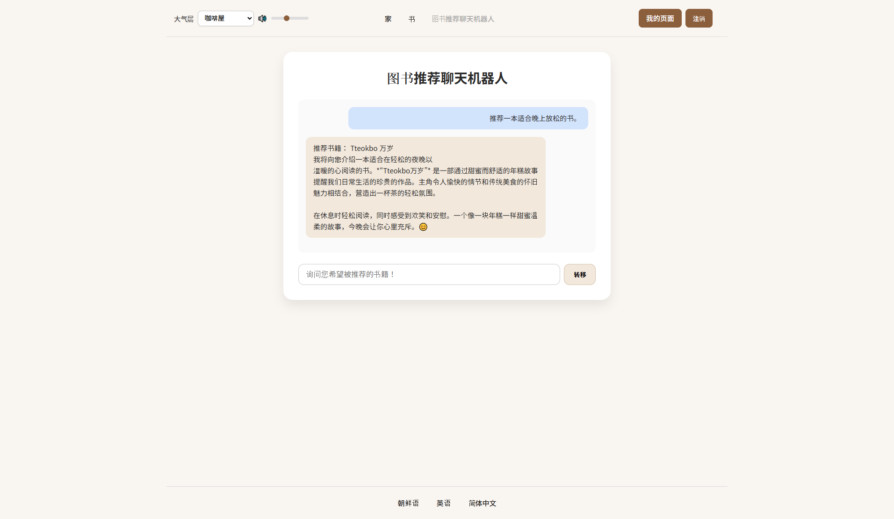

# AI 기반 도서 추천 시스템
### AI-Powered Book Recommendation System

> 사용자가 자신의 감정, 관심 주제, 독서 목적과 상황을 자연어로 설명하면, LLM의 의도 분석과 문장 임베딩 기반 검색을 결합해 관련 도서를 추천하는 온라인 서점 프로토타입입니다.

**2025년 북경과학기술대학교(北京科技大学) 컴퓨터과학기술 전공 개인 졸업프로젝트**로 기획과 데이터 처리, 추천 로직, 백엔드, 프론트엔드 및 기능 테스트를 진행했습니다.

**핵심 기술:** Vue 3, Spring Boot, Python/Flask, MySQL, DeepSeek API, e5-large-v2, Google Books API

**주요 결과:** 논문에 기록된 테스트에서 도서 16권의 AI 요약 배치 처리 시간을 611.7초에서 70.0초로, 추천 요청 전체 응답 시간을 38.015초에서 16.726초로 줄였습니다. 다만 측정 표본과 환경 정보가 제한되어 있으므로 일반적인 서비스 성능이나 정확도 보증값으로 해석하지 않습니다.

**논문 PDF 비공개 (개인정보 보호)** | [한국어 프로젝트 요약](./docs/project_summary_KR.md) | [구현 및 실험 근거](./docs/career_evidence_KR.md) | [추천 화면](./screenshots/recommendation.png)

> **공개 범위:** 민감정보를 제거한 실제 개발 원본의 Java/Spring Boot, Vue 3, Python 코드를 backend/와 frontend/에 포함했습니다. API 키와 비밀번호, 원본 데이터 CSV, 외부 콘텐츠 파일은 제외했습니다. 학술용 프로토타입이며 모든 서비스의 재실행을 보증하는 완성 배포본은 아닙니다.

## 실제 구현 화면

자연어 요청을 입력하고 추천 도서를 확인하는 학술용 프로토타입의 화면입니다. 추가 화면과 구현 근거는 아래 본문에서 확인할 수 있습니다.

## 서비스 차별성

책을 읽고 싶다는 생각은 있어도 제목이나 저자, 원하는 장르를 정확하게 설명하기 어려울 때가 있습니다. 그래서 도서 검색의 시작점을 정해진 검색어에서 사용자의 감정, 상황과 독서 목적으로 넓혔습니다. 추천 결과를 실제 도서 정보와 연결하기 위해 데이터 수집부터 추천, 도서 관리와 대출 기능까지 하나의 웹서비스로 구현했습니다.

| 설계할 때 고민한 문제 | 구현한 서비스 |
| --- | --- |
| 제목을 모르는 상태에서도 원하는 책을 찾을 수 있을까? | 자연어 질문에서 감정, 상황, 주제를 해석하고 실제 도서 설명 벡터와 비교해 후보를 찾는 추천 |
| AI가 도서 정보를 임의로 만들어 내는 위험을 어떻게 줄일까? | 보유 도서 데이터에서 후보를 먼저 선정하고, 그 제목과 요약을 LLM에 전달해 추천 이유를 작성 |
| 신규 사용자와 기존 사용자의 추천 기준을 어떻게 구성할까? | 가입 시 관심 카테고리를 받으며, 즐겨찾기와 기존 추천 도서 및 관심 분야를 조합한 별도 개인화 추천 경로 구현 |
| 도서 정보와 재고를 관리하면서 추천을 제공하려면? | ISBN 자동 등록, AI 요약, 관리자 등록 및 수정, 가격과 재고 관리, 대출과 반납에 따른 재고 증감 |
| 외부 AI 호출이 길어질 때 기다리는 시간을 어떻게 줄일까? | 도서 벡터 사전 계산, 배치 임베딩, 비동기 LLM 호출, 병렬 요약과 호출 빈도 제어 |

2025년 개인 졸업프로젝트에서 서비스 기획, 데이터 처리, AI 추천 로직, Spring Boot API, Vue 화면과 MySQL 데이터 모델을 직접 설계하고 구현했습니다. 추천 품질과 처리시간을 함께 확인했으며, 구매 주문과 결제를 구현한 상용 쇼핑몰이나 ERP는 아닙니다.

## 목차

- [1. 프로젝트 개요](#1-프로젝트-개요)
- [2. 서비스 기능과 사용자 흐름](#2-서비스-기능과-사용자-흐름)
- [3. 시스템 아키텍처](#3-시스템-아키텍처)
- [4. AI 도서 추천 파이프라인](#4-ai-도서-추천-파이프라인)
- [5. 도서 데이터 수집과 AI 요약](#5-도서-데이터-수집과-ai-요약)
- [6. 웹 서비스와 데이터 설계](#6-웹-서비스와-데이터-설계)
- [7. 성능 개선 및 검증 결과](#7-성능-개선-및-검증-결과)
- [8. 주요 화면](#8-주요-화면)
- [9. 기술 선택 및 구현 과정](#9-기술-선택-및-구현-과정)
- [10. 한계와 후속 개선](#10-한계와-후속-개선)
- [11. 저장소 구성 및 참고 문서](#11-저장소-구성-및-참고-문서)

## 1. 프로젝트 개요

### 문제 정의

일반적인 도서 탐색은 제목, 저자, 카테고리, 키워드 등 사용자가 이미 알고 있는 정보로 시작하는 경우가 많습니다. 하지만 실제로 읽고 싶은 책을 찾을 때는 정확한 제목보다 현재의 감정이나 상황이 먼저 떠오를 수 있습니다.

예를 들어 "시험 기간이라 불안한데 잠시 마음을 편하게 할 책"이나 "잠들기 전에 읽기 좋은 따뜻한 이야기"는 단일 카테고리로 분류하기 어렵습니다. 단순 단어 일치 방식만 사용하면 이러한 요청의 의도와 도서 내용 사이의 관계를 충분히 반영하기 힘들다고 판단했습니다.

도서 소개 데이터의 품질도 함께 고려했습니다. ISBN을 통해 수집한 정보에는 설명이 부족하거나 길이가 제각각인 경우가 있으므로, 추천 결과를 빠르게 검토할 수 있도록 짧은 소개를 제공할 필요가 있었습니다.

### 구현 방향

이 문제를 해결하기 위해 도서 정보를 수집하고 관리하는 일반적인 웹서비스에 자연어 추천 기능을 연결했습니다.

1. **LLM으로 입력을 해석합니다.** 사용자의 자유로운 문장을 감정, 상황, 주제와 같은 검색 기준으로 분해합니다.
2. **임베딩으로 의미를 비교합니다.** 사용자 문장과 도서 설명을 e5-large-v2로 벡터화하고, 코사인 유사도를 계산합니다.
3. **여러 판단 기준을 결합합니다.** 문장 유사도와 감정, 상황, 주제별 유사도에 가중치를 적용해 추천 후보를 정렬합니다.
4. **추천 결과를 서비스에 연결합니다.** 상위 도서 정보를 바탕으로 LLM이 추천 설명을 생성하고, 웹 화면에서 책을 확인하거나 저장할 수 있도록 구성했습니다.
5. **도서 데이터를 함께 관리합니다.** ISBN 일괄 등록, AI 요약 생성, 관리자 권한, 검색, 즐겨찾기와 대출 기능을 갖추었습니다.

이 프로젝트에서는 자연어 추천과 별도로 사용자 관심 분야, 즐겨찾기 및 추천 도서를 활용하는 개인화 추천 경로를 마련했습니다. 책을 찾은 이후에는 상세 정보를 확인하고 관심 목록에 저장하거나 대출할 수 있도록 연결했으며, 관리자가 도서 정보와 재고를 관리할 수 있게 구성했습니다. 행동 데이터를 지속 학습하는 추천 엔진이나 대규모 상용 서비스로 검증된 것은 아닙니다.

### 프로젝트 정보

| 항목 | 내용 |
| --- | --- |
| 유형 | 개인 졸업프로젝트, 학술용 웹서비스 프로토타입 |
| 기간 | 2025.01 ~ 2025.06 |
| 학교 | 북경과학기술대학교, 컴퓨터과학기술 전공 |
| 담당 | 문제 정의, 기능 및 DB 설계, 도서 데이터 처리, AI 추천과 요약 연동, 프론트엔드 및 백엔드 구현, 테스트 |
| 주요 문서 | 졸업논문 「网上书店的设计与实现」(Design and Implementation of an Online Bookstore) |

## 2. 서비스 기능과 사용자 흐름

### 자연어로 책 찾기

사용자는 검색어를 정확히 알지 못해도 채팅 형태로 독서 목적을 전달할 수 있습니다. 논문에서 다룬 입력의 예시는 다음과 같습니다.

| 입력 상황 | 추천 시스템에서 확인하는 정보 |
| --- | --- |
| "최근 스트레스가 심해서 가벼운 소설을 읽고 싶어요." | 감정 및 정서적 요구, 휴식 목적, 소설 주제 |
| "프로그래밍 실력을 키울 수 있는 책이 있을까요?" | 기술 학습 목적, 프로그래밍 관련 주제 |
| "잠들기 전에 읽을 따뜻한 이야기를 찾고 있어요." | 취침 전이라는 상황, 정서적 분위기, 이야기 형식 |
| "시험 준비에 도움이 되는 실용서를 추천해 주세요." | 시험 준비 상황, 효율 향상 목적, 실용서 주제 |

위 표의 해석 항목은 기능을 이해하기 위한 설명이며, 특정 문장에 대해 실제 모델이 출력한 JSON 값을 그대로 인용한 것은 아닙니다.

### 일반 사용자 기능

- 회원가입과 로그인, JWT 기반 인증
- 가입 시 관심 카테고리 최소 3개 선택
- 카테고리 탐색, 제목과 저자 등의 키워드 검색, 도서 상세 조회
- 자연어 채팅을 이용한 도서 추천과 추천 결과 확인
- 관심 도서 즐겨찾기, 추천 이력 조회 및 목록 관리
- 도서 대출과 반납, 대출 상태 확인
- 카페, 도서관, 자연 등 테마의 배경 음악 선택과 재생 제어

### 관리자 기능

- ISBN 목록 파일을 통한 도서 정보 일괄 등록
- Google Books API로 가져온 도서 정보 확인
- 도서 등록, 수정, 카테고리 관리
- 가격 및 재고 수량 변경
- 도서 삭제 API를 통한 삭제 처리 (실제 구현은 물리 삭제)

추천에 사용할 도서 정보가 부족하거나 외부 API에서 가져온 내용이 잘못된 경우에도 운영자가 수정할 수 있도록 ISBN 등록과 수동 등록을 함께 마련했습니다. [BookRegister.vue](./frontend/src/components/BookRegister.vue), [BookEdit.vue](./frontend/src/components/BookEdit.vue) 및 [BookController.java](./backend/src/main/java/com/bookstore/backend/controller/BookController.java)에서 도서 등록과 가격, 재고 수정 화면 및 API를 확인할 수 있습니다. 일반 사용자와 관리자의 기능을 구분했으나 모든 서버 측 인가 경로를 검증한 것은 아닙니다.

## 3. 시스템 아키텍처

논문 3장에서는 Vue 3 프론트엔드, Spring Boot REST API, MySQL, Python Flask AI 서비스로 역할을 분리한 구조를 제시합니다.

~~~text
┌──────────────────────────────────────────┐
│                Vue 3 SPA                 │
│ 도서 탐색 / 로그인 / 추천 대화 / MyPage   │
└────────────────────┬─────────────────────┘
                     │ Axios / REST API
                     ▼
┌──────────────────────────────────────────┐
│            Spring Boot Backend           │
│ 사용자 및 권한 / 도서 / 즐겨찾기 / 대출   │
│ API 요청 처리 및 데이터 관리             │
└─────────────┬────────────────┬───────────┘
              │                │ HTTP
              ▼                ▼
┌──────────────────┐   ┌─────────────────────────┐
│      MySQL       │   │    Python / Flask       │
│ Users / Books    │   │ 자연어 분석 및 추천     │
│ Favorites        │   │ e5-large-v2 임베딩      │
│ Recommendations  │   └────────────┬────────────┘
└──────────────────┘                │
                                    ▼
                         ┌─────────────────────┐
                         │     DeepSeek API    │
                         │  의도 해석 / 설명   │
                         └─────────────────────┘

도서 입력 경로: ISBN 목록 → Google Books API → Books 테이블
도서 설명 경로: Books → AI 요약 배치 → DeepSeek Reasoner → Books
~~~

| 구성 요소 | 맡은 역할 |
| --- | --- |
| **Vue 3, Axios** | 화면 상태와 사용자 입력 처리, REST API 호출 |
| **Spring Boot** | 회원과 도서 관리, JWT 인증, 비즈니스 로직 |
| **MySQL** | 도서, 사용자, 즐겨찾기 및 추천 기록 등 구조화된 데이터 보관 |
| **Python, Flask** | 추천 요청 처리, 모델 호출, 의미 기반 도서 검색 |
| **DeepSeek V3** | 사용자의 감정, 상황, 주제 및 독서 의도 분석 |
| **e5-large-v2** | 자연어 문장과 도서 내용의 벡터 표현 생성 |
| **DeepSeek Reasoner** | 도서 설명을 짧게 압축하는 AI 요약 |
| **Google Books API** | ISBN에 해당하는 제목, 저자, 소개, 표지 등의 메타데이터 수집 |

공개된 [ChatService.java](./backend/src/main/java/com/bookstore/backend/service/ChatService.java)와 [PersonalRecommendationService.java](./backend/src/main/java/com/bookstore/backend/service/PersonalRecommendationService.java)는 Spring Boot에서 Flask의 자연어 추천 및 개인화 추천 API를 호출합니다. [chat_server.py](./backend/chat_server.py)는 두 추천 경로를 분리합니다. 실제 개발 소스의 구성은 확인했으나 공개용 환경에서 전체 서비스의 정상 기동을 검증한 것은 아닙니다.

## 4. AI 도서 추천 파이프라인

### 4.1 전체 처리 순서

~~~text
사용자 자연어 질문
        │
        ▼
DeepSeek V3: 감정, 상황, 주제와 가중치 해석
        │
        ├───────────┐
        ▼           ▼
질문 및 해석된 항목을 e5-large-v2로 임베딩
        │
        ▼
미리 만들어 둔 도서 설명 벡터와 비교
        │
        ▼
코사인 유사도 계산
        │
        ▼
가중 합산 및 패널티를 적용한 순위 결정
        │
        ▼
상위 5개 도서 후보 선정 (최상위 점수 기준 미달 시 추천 중단)
        │
        ▼
후보 도서의 제목과 요약을 전달해 LLM이 한 권을 선택하고 추천 설명 생성
        │
        ▼
채팅 답변 및 도서 카드로 사용자에게 표시
~~~

### 4.2 입력 의도 분석

추천 요청의 시작점은 사용자의 자연어 문장입니다. 논문 4.1.4절과 부록 A.5에서는 DeepSeek를 이용해 질문에서 **감정(感情), 상황(情况), 주제(主题)** 정보를 추출하는 방식을 설명합니다.

예를 들어 "요즘 시험 때문에 마음이 불안한데 편히 읽을 책"은 단일 키워드인 '시험'만으로 설명하기 어렵습니다. 의도 분석 단계에서는 시험이라는 상황, 불안이라는 감정, 부담 없이 읽고 싶다는 독서 목적을 각각 추천 판단에 활용하는 방향으로 설계했습니다.

[embedding_query.py](./backend/embedding_query.py)에서는 도서 추천에 해당하는 질문인지 분류하는 요청과 감정, 상황, 주제를 분석하는 요청을 비동기로 시작합니다. 분석 응답을 JSON으로 파싱하고, 파싱 실패 시 빈 정보로 처리하며, 가중치가 없으면 세 항목에 각각 1/3을 적용합니다. 도서 추천과 관련 없는 요청에는 별도 안내를 반환합니다.

### 4.3 임베딩 및 의미 기반 검색

키워드가 겉으로 같지 않아도 의미가 가까운 책을 찾기 위해 e5-large-v2 문장 임베딩 모델을 도입했습니다.

- **입력 측:** 원본 질문과 추출된 감정, 상황, 주제 정보를 각각 벡터로 변환합니다.
- **도서 측:** 책의 설명 및 요약 정보를 벡터로 표현합니다.
- **비교 단계:** 각 입력 벡터와 도서 벡터의 코사인 유사도를 계산합니다.
- **후보 정렬:** 의미 유사도에 가중치 및 추가 조건을 반영한 점수로 상위 도서를 추립니다.

코사인 유사도는 두 벡터의 방향이 얼마나 유사한지를 나타냅니다.

~~~text
cosine_similarity(a, b) = dot(a, b) / (norm(a) * norm(b))
~~~

공개 소스에서는 도서 벡터 CSV를 서비스 시작 시 읽고, 질문과 감정, 상황, 주제의 네 문장을 하나의 배치로 임베딩합니다. CUDA 사용이 가능하면 GPU를 선택하고, 그렇지 않으면 CPU를 사용합니다. `util.cos_sim`으로 각 유사도를 계산하고 `torch.topk`로 후보를 선정합니다. 실제 도서 벡터 데이터는 공개 대상에서 제외했습니다.

### 4.4 가중치 기반 점수 계산

논문 부록 A.5에 실린 핵심 계산식은 아래와 같은 구조입니다.

~~~text
base_score =
    0.30 * similarity(question, book)
  + w_emotion   * similarity(emotion, book)
  + w_situation * similarity(situation, book)
  + w_topic     * similarity(topic, book)

total_score = base_score * penalty_factor
~~~

여기서 `w_emotion`, `w_situation`, `w_topic`은 의도 분석 결과에서 가져오는 가중치입니다. 원본 질문 유사도에는 0.30을 적용하고, 감정, 상황, 주제의 각 유사도가 0.50보다 낮을 때마다 패널티 계수를 0.15만큼 감소시킵니다. 계수의 하한은 0이며, 최상위 후보의 최종 점수가 0.65 미만이면 관련성 높은 도서를 찾지 못했다는 응답을 반환합니다. 이 값은 공개된 `embedding_query.py`의 설정이며, 일반화된 최적 임계값이라고 검증한 것은 아닙니다.

논문에서 설명한 관심 분야 활용은 아래 4.6절의 별도 개인화 추천 경로에서도 확인됩니다. 자연어 질문에 대한 가중점수 계산과 사용자별 개인화 추천을 같은 점수 산식으로 설명하지 않습니다.

### 4.5 상위 후보와 LLM 응답 생성

추천 과정은 점수가 높은 책 제목만 나열하는 단계에서 끝나지 않습니다. 부록의 'embedding_query.py' 부분에는 상위 후보의 **제목과 요약을 하나의 문맥으로 구성한 뒤 DeepSeek에 전달해 최종 추천 메시지를 생성하는 흐름**이 나타납니다.

따라서 이 프로젝트의 추천 로직은 다음처럼 구분할 수 있습니다.

- **후보 검색 및 순위 결정:** 임베딩 유사도와 가중점수 계산
- **사용자에게 보여줄 설명 생성:** 선정된 후보 도서 정보를 바탕으로 LLM 호출

검색된 도서 정보가 LLM 응답의 문맥으로 사용된다는 점에서 검색과 생성을 연결한 형태입니다. 다만 완전한 RAG 프레임워크, 출처 검증 또는 환각 방지 기능이 구현되었다고 주장하지 않습니다.

### 4.6 신규 사용자와 추천 기록

가입 시 최소 3개 관심 분야를 선택하도록 한 것은 행동 이력이 거의 없는 사용자에게도 초기 관심 정보를 제공하기 위한 설계입니다. 이는 콜드스타트의 일부를 완화하려는 방법이지, 문제를 일반적으로 해결했다는 의미는 아닙니다.

추천 결과는 사용자 계정과 연결된 기록으로 관리하며, 사용자는 MyPage에서 이전 추천과 즐겨찾기 도서를 다시 확인할 수 있습니다. 또한 개인화 추천에서는 즐겨찾기와 추천 이력의 도서 벡터를 평균하고 관심 카테고리 벡터를 별도로 계산합니다. 두 정보가 모두 있으면 카테고리 벡터에 0.05의 가중치를 적용해 사용자 벡터를 구성한 뒤 상위 5개 도서 ID를 반환하도록 구현했습니다. [PersonalRecommendationService.java](./backend/src/main/java/com/bookstore/backend/service/PersonalRecommendationService.java)와 `embedding_query.py`의 `recommend_books_by_profile`에서 확인할 수 있습니다. 클릭과 평가 데이터를 학습하는 방식은 아니며, 관심 분야만 있는 신규 사용자의 추천 경로를 포함한 전체 예외 상황은 재실행 검증이 필요합니다.

## 5. 도서 데이터 수집과 AI 요약

### 5.1 ISBN 기반 도서 정보 입력

도서 정보를 관리자가 일일이 입력하면 초기 데이터를 확보하는 데 시간이 많이 걸립니다. 이를 줄이기 위해 ISBN 목록으로 도서 메타데이터를 일괄 가져오는 방식을 사용했습니다.

~~~text
관리자 ISBN 목록 입력
       ↓
ISBN 파일 읽기
       ↓
Google Books API에서 메타데이터 조회
       ↓
Books 테이블에 저장
       ├─ 성공: 제목, 저자, 표지, 설명 및 분류 저장
       └─ 실패: failed_isbn_list.txt에 ISBN 기록
       ↓
목록 기반 등록 처리 완료
~~~

[IsbnBatchRegistrar.java](./backend/src/main/java/com/bookstore/backend/batch/IsbnBatchRegistrar.java)는 ISBN 목록을 순회하면서 등록 여부를 확인하고, 성공 데이터를 저장하고 실패 항목을 별도 파일에 기록합니다. [GoogleBooksService.java](./backend/src/main/java/com/bookstore/backend/service/GoogleBooksService.java)는 13자리 숫자 형식, ISBN 앞 12자리 중복 여부, 체크디지트 보정 후 외부 API 조회를 처리합니다. 등록한 도서에 요약이 없으면 AI 요약 작업과도 연결합니다. 처리 후 입력 ISBN 목록을 비우므로 실패 목록을 별도로 확인해야 하며, 자동 복구를 보장하지 않습니다.

### 5.2 AI를 이용한 도서 요약

일부 도서는 소개 글이 없거나 설명이 길어 목록 화면에서 내용을 비교하기 어렵습니다. 그래서 요약이 비어 있거나 이전에 요약 생성에 실패한 도서를 선별해 DeepSeek Reasoner로 짧은 소개와 카테고리를 생성하도록 구성했습니다.

~~~text
Books에서 summary 누락 또는 이전 실패 레코드 조회
       ↓
배치 작업 생성 및 ExecutorService에 제출
       ↓
RateLimiter로 외부 API 호출 빈도 조절
       ↓
DeepSeek Reasoner에 제목 및 설명 전달
       ↓
생성된 요약 및 카테고리를 해당 Book 레코드에 저장
       └─ 오류: 실패 메시지 저장 및 로그 기록
~~~

[BookSummaryBatchRunner.java](./backend/src/main/java/com/bookstore/backend/batch/BookSummaryBatchRunner.java)는 요약이 null, 공백 또는 실패 메시지인 도서를 대상으로 작업을 생성합니다. 실제 코드에서 12개 스레드와 초당 4회의 RateLimiter를 확인했으며, 성공 시 결과를 저장하고 실패 시 해당 도서의 요약 필드에 실패 메시지를 기록합니다. 다음 배치 실행 시 실패한 도서를 다시 처리 대상으로 포함할 수 있도록 했습니다.

- **중복 처리 완화:** 요약 누락 또는 이전 실패 도서에만 AI 호출
- **병렬 실행:** 요청을 스레드풀에 제출해 대기 시간을 겹쳐 처리
- **외부 호출 제어:** 요청 집중으로 인한 실패를 줄이기 위해 RateLimiter 사용
- **실패 처리:** 실패 상태를 기록하고 다른 작업을 계속 진행하며 다음 배치 실행 시 재처리 대상에 포함

**설계와 코드의 차이:** 논문 5.3절에는 최대 40개 스레드, 초당 4회 제한이라고 기재되어 있지만, 부록 A.4에서 실제 확인되는 'Executors.newFixedThreadPool(12)'의 스레드 수는 **12개**입니다. 요약 처리 설명에서는 코드로 확인되는 12개를 기준으로 하며, 40개는 논문에 별도로 적힌 최적화 설정으로 구분합니다. 모든 실행 환경에서 40개가 적용되었다고 단정하지 않습니다.

## 6. 웹 서비스와 데이터 설계

### 6.1 주요 엔티티

논문의 E-R 설계를 실제 공개 코드의 JPA 엔티티 및 관계 테이블과 대조했습니다.

| 데이터 | 용도 및 대표 필드 |
| --- | --- |
| `users` | 사용자 이름, 이메일, 암호화된 비밀번호, 관심 분야, 역할 |
| `book` | ISBN, ISBN prefix, 판본, 제목, 저자, 출판사, 설명, AI 요약, 가격, 재고 수량, 카테고리, 이미지 URL |
| `user_favorites` | 사용자와 즐겨찾기 도서 간 다대다 관계 |
| `user_recommendations` | 사용자와 추천 도서 간 다대다 관계 |
| `user_borrowed_books` | 사용자와 현재 대출한 도서 간 다대다 관계 |

[Book.java](./backend/src/main/java/com/bookstore/backend/model/Book.java), [User.java](./backend/src/main/java/com/bookstore/backend/model/User.java)의 관계 매핑을 기준으로 정리했습니다. 논문에는 대출 시각 등의 상태 정보도 설명되어 있으나 실제 공개 엔티티에는 별도 대출 시각이나 반환 시각 필드가 없습니다.

도서 등록과 검색만 제공하면 사용자가 이미 선택한 도서의 현재 이용 가능 여부를 알기 어렵습니다. 그래서 [BookService.java](./backend/src/main/java/com/bookstore/backend/service/BookService.java)에서 사용자별 대출 관계와 재고 수량을 함께 변경하도록 구현했습니다.

~~~java
// 대출 가능 여부와 사용자별 중복 대출을 확인한 후
book.setStock(book.getStock() - 1);

// 해당 사용자의 대출 여부를 확인한 후
book.setStock(book.getStock() + 1);
~~~

대출 시 이미 대출했거나 재고가 없는 도서는 거부하고, 반납 시에는 해당 사용자가 실제로 대출한 도서인지 확인합니다. 이후 사용자와 도서의 대출 관계 및 재고 수량을 저장합니다. [BookDetail.vue](./frontend/src/components/BookDetail.vue)에서는 도서 정보와 가격, 현재 재고 및 대출, 반납 관련 화면을 구성했습니다.

이는 도서 대출 가능 재고 관리로, 판매 주문과 결제에 따른 출고 또는 상용 ERP의 재고 수불 전표, 구매, 회계 모듈과는 구분됩니다. 다중 요청 동시성 및 재고 변동 감사 로그는 추가 검증과 개선이 필요합니다.

### 6.2 인증과 권한

로그인 후 JWT 토큰을 전달받아 보호된 API 요청에 사용하도록 설계했습니다. 논문에는 브라우저의 'localStorage'에 토큰을 보관하고 요청 헤더로 전달한다는 설명이 있습니다.

| 기능 | 일반 사용자 | 관리자 |
| --- | :---: | :---: |
| 책 탐색과 검색 | 가능 | 가능 |
| 즐겨찾기 및 추천 이력 | 가능 | 가능 |
| 도서 대출 및 반납 | 가능 | 가능 |
| 도서 신규 등록 및 ISBN 일괄 입력 | 제한 | 가능 |
| 가격, 재고, 도서 정보 수정 | 제한 | 가능 |
| 도서 삭제 | 제한하도록 설계 | 가능 |

위 권한 구분은 서비스 화면과 설계상의 역할을 정리한 것입니다. 현재 `SecurityConfig.java`는 `/api/books/**`를 공개 경로로 설정하므로 관리자 전용 변경 API의 서버 측 인가를 운영 수준으로 보장한다고 주장하지 않습니다. 논문에는 논리 삭제가 설명되지만, 실제 `BookService.deleteBook`은 `bookRepository.deleteById(id)`를 호출하는 **물리 삭제**입니다.

**보안 및 공개 범위:** 이 프로젝트는 학술용 프로토타입입니다. 원본 소스의 JWT 고정 서명키는 공개 버전에서 환경변수로 변경했습니다. 이전 키는 재사용하지 않아야 합니다. 운영 전에는 키를 외부 비밀정보 관리 방식으로 옮기고, 토큰 보관 방식과 권한 검증을 추가 점검해야 합니다.

### 6.3 주요 API의 예시

실제 [BookController.java](./backend/src/main/java/com/bookstore/backend/controller/BookController.java), [UserController.java](./backend/src/main/java/com/bookstore/backend/controller/UserController.java) 및 추천 관련 컨트롤러를 기준으로 주요 경로를 정리했습니다.

| 예시 경로 | 내용 |
| --- | --- |
| `GET /api/books/paged` | 도서 목록 페이지네이션 |
| `GET /api/books/search-paged` | 도서 검색 페이지네이션 |
| `POST /api/books/register-isbn` | ISBN 기반 도서 등록 |
| `POST /api/books/manual` | 직접 입력을 통한 도서 등록 |
| `PUT /api/books/{id}` | 도서 정보와 가격, 재고 등 수정 |
| `DELETE /api/books/{id}` | 도서 물리 삭제 |
| `POST /api/books/{id}/borrow` | 대출 관계 추가 및 재고 감소 |
| `POST /api/books/{id}/return` | 대출 관계 제거 및 재고 증가 |
| `GET /api/users/me/favorites` | 사용자의 즐겨찾기 조회 |
| `GET /api/users/me/recommendations` | 사용자의 추천 도서 조회 |
| `GET /api/users/me/borrowed` | 사용자의 대출 도서 조회 |
| `DELETE /api/users/me/recommendation/{bookId}` | 추천 목록 항목 삭제 |

위 표는 전체 REST API 명세가 아닌 원본 코드에서 확인한 주요 엔드포인트입니다.

## 7. 성능 개선 및 검증 결과

논문 5장에는 AI 요약 생성과 도서 추천에 대해 최적화 전후 로그를 비교한 결과가 있습니다.

### 7.1 성능 비교

| 측정 항목 | 개선 전 | 개선 후 | 변화 |
| --- | ---: | ---: | ---: |
| AI 요약 배치 처리, 16권 | 611.7초 | 70.0초 | 약 8.74배 빠름 |
| 추천 요청 전체 응답 | 38,015ms | 16,726ms | 약 2.27배 빠름 |
| 논문에서 별도로 기록한 키워드 분석 및 임베딩 관련 구간 | 117ms | 37ms | 약 3.16배 빠름 |

- **요약 성능:** 16권을 처리한 로그를 기준으로 전체 완료 시간을 비교했습니다. 작업당 평균 경과 시간으로 환산하면 개선 전 약 38.2초, 개선 후 약 4.38초입니다. 이 평균은 전체 배치 시간을 책 수로 나눈 값으로, 병렬 실행 중 개별 요청 하나의 평균 지연 시간과 동일하지 않습니다.
- **추천 성능:** 임베딩 및 분석 관련 처리 구간은 비교적 짧았지만, 전체 요청은 외부 LLM 응답 대기에 크게 영향을 받았습니다. 논문에는 'asyncio' 기반 호출 방식과 캐시 관련 최적화가 언급됩니다.
- **측정 해석:** 로그에 남은 사례의 전후 비교이며, 서버 사양, 테스트 반복 횟수, 요청 동시성, 네트워크 상태에 대한 완전한 실험 조건은 공개되지 않았습니다. 따라서 수치는 논문 당시의 관찰 결과로 제시합니다.

### 7.2 추천 결과의 정성 평가

논문 5.2.3절에서는 감정 완화, 프로그래밍 학습, 자기 탐색, 취침 전 독서, 시험 준비 등 **5개 자연어 요청**으로 추천 결과를 확인하고, 각 요청의 추천 도서를 주관적으로 평가했습니다.

| 평가 범위 | 논문에 기록된 결과 |
| --- | --- |
| 입력 질문 | 5개 |
| 각 질문의 후보 | Top-5 |
| 결과 평가 | 5개 질문 모두 '매우 만족'으로 표기 |
| 평가 방식 | 사용자 주관 평가 |

이는 제한된 시나리오에서의 기능 확인 및 정성적인 적합성 평가입니다. **정답 레이블이 있는 데이터셋으로 측정한 Precision@K, Recall@K, NDCG, 일반화 정확도 또는 외부 사용자 만족도 조사 결과는 아닙니다.** 추후에는 평가자 수와 판단 기준을 정하고 다양한 입력을 반복 측정할 필요가 있습니다.

### 7.3 개선을 위해 적용하거나 검토한 방법

| 방법 | 논문에서 확인되는 범위 | 주의할 점 |
| --- | --- | --- |
| 스레드풀과 호출 빈도 제어 | 요약 배치 코드와 전후 테스트 기록 | 스레드 수의 서술과 부록이 서로 다름 |
| 요약 누락 또는 이전 실패 도서 선별 | 실제 배치 코드의 필터 조건 | 재실행 시 재처리 대상에 포함되며 자동 복구는 별도 검증 필요 |
| 도서 벡터 사전 계산 | CSV 로딩 및 메모리 재사용 코드, 논문 5장 설명 | 실제 CSV는 미공개이며 갱신 및 무효화 정책은 추가 검증 필요 |
| 비동기 LLM 요청 | 질문 분류 및 의도 분석을 asyncio 작업으로 병렬 시작 | 동시 사용자 부하 테스트는 미수행 |
| 예외 기록 | ISBN 처리 및 요약 배치 부록 | 복구 및 재시도 정책까지 구현했다고 단정할 수 없음 |

## 8. 주요 화면

### 자연어 도서 추천

사용자가 문장으로 요구를 전달하고, AI 응답과 도서 추천 결과를 확인하는 화면입니다.

### AI 요약이 표시된 도서

도서 메타데이터와 짧게 정리한 내용을 카드 형태로 확인할 수 있습니다.

### 즐겨찾기와 추천 이력

선택한 도서를 보관하고, 이전에 추천받은 목록을 MyPage에서 다시 확인하는 화면입니다.

## 9. 기술 선택 및 구현 과정

### 자연어 해석과 의미 검색을 분리한 이유

LLM만으로 도서 추천 문장을 생성하면 실제 보유 도서와 답변을 연결하기 어렵습니다. 반대로 단순 키워드 검색만 사용하면 사용자가 표현한 감정과 상황을 반영하기 어렵습니다. 그래서 **의도 분석은 LLM, 실제 도서 후보 검색은 임베딩 유사도, 최종 설명은 후보 도서 기반 LLM 응답**으로 역할을 나누었습니다.

이 방식에서는 책을 더 많이 수집하더라도 도서 검색의 기반 데이터를 유지할 수 있고, 추천 설명도 선택된 후보를 바탕으로 만들 수 있습니다. 다만 전체 추천 근거의 일관성과 환각 억제 성능까지 정량 평가한 것은 아닙니다.

### 도서 데이터 수집과 표현을 함께 설계한 이유

추천에 사용할 도서 정보를 확보하기 위해 ISBN 목록과 Google Books API를 연결했습니다. 또한 책 소개가 비어 있는 경우에는 요약을 채워 도서 카드를 구성하도록 했습니다. 데이터 수집, 요약 생성, 벡터 비교, 웹 화면 표시가 이어지는 흐름을 한 시스템에서 구현했다는 점이 이 개인 프로젝트의 주요 범위입니다.

### 추천 이후의 이용 과정과 관리 기능을 연결한 이유

자연어 추천으로 도서를 찾더라도 재고가 없거나 상세 정보가 부족하면 사용자는 다음 행동을 결정하기 어렵습니다. 그래서 추천과 검색에 동일한 도서 데이터를 사용하고, 상세 화면에서 도서 정보와 재고를 확인한 뒤 관심 목록에 저장하거나 대출할 수 있도록 구성했습니다. 관리 기능도 ISBN 자동 등록뿐 아니라 직접 등록과 수정이 가능하도록 만들었습니다. 추천 후보의 품질을 관리하는 일과 실제 이용 가능한 도서의 상태를 관리하는 일이 연결되는 구조로 구현한 것입니다.

### 처리 시간이 길어진 원인을 나누어 본 이유

추천 과정에서 임베딩 계산만 빠르게 만들어서는 사용자가 결과를 기다리는 시간이 충분히 줄어들지 않았습니다. 논문의 전후 로그에는 임베딩 관련 구간보다 LLM 호출 대기 시간이 큰 비중을 차지하는 것으로 나타납니다. 그래서 비동기 처리, 사전 계산과 캐시, 외부 요청 제어를 성능 개선 항목으로 다뤘습니다.

이는 2025년 당시 학술 프로젝트에서 진행한 실험과 설계 기록입니다. 현재 동일한 성능을 보장하거나, 모든 설정을 재현 가능한 실행 코드로 공개했다는 의미는 아닙니다.

### 기술 구성 정리

| 영역 | 주요 기술 |
| --- | --- |
| 프론트엔드 | Vue 3, Axios, HTML5 Audio |
| 백엔드 | Java, Spring Boot, REST API, JWT |
| AI 서비스 | Python, Flask, DeepSeek API |
| 자연어 임베딩 | e5-large-v2, SentenceTransformer 계열, 코사인 유사도 |
| 데이터 | MySQL, Google Books API |
| 배치 및 성능 | Java Executors, Guava RateLimiter, 비동기 호출, 벡터 사전 계산과 캐시 설계 |

Java와 프론트엔드 의존성은 각각 [pom.xml](./backend/pom.xml), [package.json](./frontend/package.json)에서 확인할 수 있습니다. Python 환경 및 외부 모델과 데이터의 재현 조건은 11장에서 별도로 설명합니다.

## 10. 한계와 후속 개선

프로젝트를 마친 시점에 남아 있는 제약도 논문 5.4장과 6장에 정리했습니다.

| 현재 한계 | 후속 개선 방향 |
| --- | --- |
| 외부 LLM API의 응답 시간과 호출 제한에 영향받음 | 캐시 정책 명확화, 장애 복구, 재시도 및 대체 응답 설계 |
| 신규 사용자 관심 분야를 사용하지만 지속적인 행동 학습은 없음 | 클릭, 선택, 건너뛰기 피드백을 수집해 추천 로직 개선 |
| 도서 수가 많아질 때의 검색 성능 검증이 부족함 | 벡터 인덱스 및 전용 검색 저장소 도입 검토 |
| 추천 적합성 테스트가 5개 주관 평가에 한정됨 | 정답셋 구성, 평가자 확대, Precision@K 등의 지표 추가 |
| 재고 변경 및 삭제 이력 관리, 동시 대출 검증이 제한적임 | 트랜잭션과 동시성 제어 검증, 관리자 감사 로그 및 재고 변동 기록 확장 |
| PC 중심 인터페이스 | 모바일 화면과 접근성 개선 |
| 실운영 보안 설정 및 실행 재현성 검증 불가 | 관리자 API 서버 측 인가, 토큰 보관 방식, 실행 환경과 빌드 및 배포 검증 |

**협업 필터링 모델의 실구현, 대규모 사용자 데이터를 통한 학습, 정식 벡터 DB 운영, 상용 배포 또는 실사용자 전환율 개선은 이 README의 구현 성과로 주장하지 않습니다.**

## 11. 저장소 구성 및 참고 문서

개인 졸업 프로젝트 개발 원본에서 민감정보를 제외해 공개한 저장소의 구성입니다.

~~~text
AI-Powered-Book-Recommendation-System/
├── README.md
├── .env.example
├── .gitignore
├── backend/                     # Spring Boot, Python AI 관련 소스
│   ├── pom.xml
│   ├── embedding_query.py
│   ├── src/main/java/com/bookstore/backend/
│   └── src/main/resources/      # 비밀값 대신 환경변수
├── frontend/                    # Vue 3 애플리케이션
│   ├── package.json
│   └── src/
├── docs/
│   ├── project_summary_KR.md
│   └── career_evidence_KR.md
└── screenshots/
    ├── ai_summary.png
    ├── favorites.png
    ├── recommendation.png
    └── recommended.png
~~~

- **중국어 졸업논문:** 학번 등 식별정보가 포함되어 원문 PDF는 공개하지 않습니다. 검증된 설계, 구현과 실험 결과는 README 및 한국어 근거 문서에 정리했습니다.
- **[한국어 프로젝트 요약](./docs/project_summary_KR.md):** 기술 개요와 기존 정리 자료입니다. README와 표현 또는 수치가 다를 때는 해당 주장에 연결된 논문 원문과 공개된 코드 근거를 우선합니다.
- **[구현 및 실험 근거](./docs/career_evidence_KR.md):** 실제 소스의 구현 범위와 논문에 기록된 성능 결과를 구분해 정리했습니다.
- **[GitHub 프로필](https://github.com/Luriar):** 프로젝트 작성자 및 다른 개발 활동을 확인할 수 있습니다.

### 실행 및 재현에 관하여

Java, Vue 및 Python 실제 소스와 빌드 설정을 공개했습니다. 원본과 달리 API 키, DB 암호, JWT 서명키는 환경변수로 분리했습니다. 원본 데이터와 벡터 CSV, ISBN 오류 목록, 실제 음원 및 출처를 검증하지 못한 다운로드 이미지, 논문 PDF는 제외했습니다.

1. JDK, Maven과 MySQL을 준비하고 `backend/pom.xml`을 확인합니다.
2. [.env.example](./.env.example)을 참고해 DB_URL, DB_USER, DB_PASSWORD, JWT_SECRET, DEEPSEEK_API_KEY 값을 개인 환경변수로 설정합니다. 실제 비밀값은 Git에 등록하지 않습니다.
3. 프론트엔드는 Node.js 환경에서 의존성을 설치하고 API 주소를 확인합니다.
4. Python 추천 서버의 모델, 패키지, 도서 데이터와 사전 계산 벡터를 별도로 준비합니다. 원본의 일부 파일 경로와 누락된 리소스는 로컬 환경에 맞게 조정해야 합니다.

~~~bash
# 프론트엔드
cd frontend
npm install
npm run dev

# 별도 터미널에서 JDK와 DB 설정 후
cd backend
./mvnw spring-boot:run
~~~

이 명령은 개발 환경 진입 예시이며 전체 서비스가 동일하게 동작하는지 재실행 검증한 결과는 아닙니다. 공개 소스와 논문 원자료에 근거해 구현 내용을 정리했으며, 기존 API 키나 JWT 서명키가 사용 중이었다면 별도로 폐기하고 재발급해야 합니다. 논문 PDF를 제외한 일반 Git 이력은 정리했으나 외부 사본이나 과거 GitHub 캐시의 삭제까지 보장하지 않습니다.

---

**작성자:** 윤준호 (Yoon Joonho)  
**개발 기간:** 2025년 1월 ~ 6월  
**프로젝트 성격:** 북경과학기술대학교 컴퓨터과학기술 전공 개인 졸업프로젝트  
**문의:** [연락처 비공개]

본 저장소의 공개 자료는 학술 프로젝트의 설계 및 구현 기록입니다. 별도의 라이선스 파일이 현재 포함되어 있지 않으며, 이를 상업적 이용 허가로 해석하지 않습니다.
